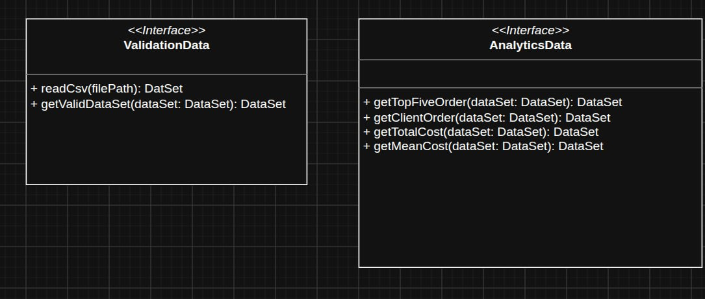
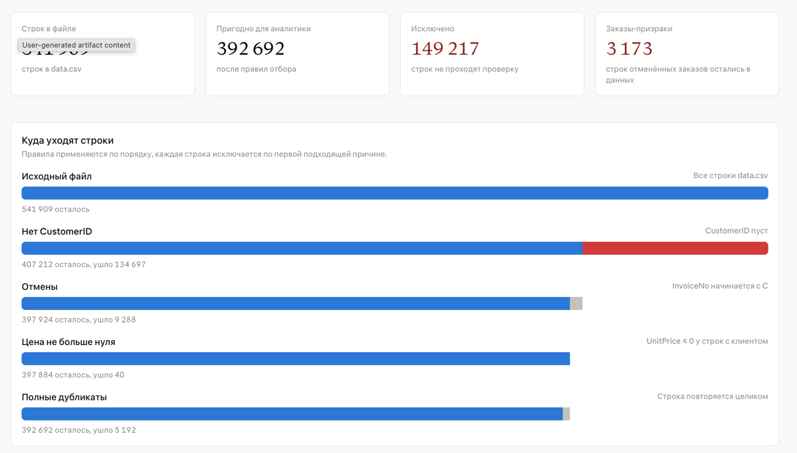

# Практическое занятие 2.

**Группа Р4150**

- Буров С.А.
- Бушмелёв К.А.
- Садовая А.Р.
- Халдин Д.А.

### 1. Интерфейсы



### 2. Загрузка и предварительная обработка данных



Приложение `org.itmo.Main` за один запуск читает CSV, выполняет предобработку (`DatasetPreparatorSpark`), а затем аналитику (`SparkAnalyticsData`) на очищенных данных.

## Запуск

Сначала собрать jar (из корня проекта):

```bash
./gradlew jar
```

После любого изменения кода jar нужно пересобрать.

### Через Docker Compose

Spark устанавливать не нужно:

```bash
docker compose --profile lab1 up --exit-code-from spark-submit-lab1
```

Поднимаются Spark master и worker, затем на кластере выполняется задача. После её завершения всё останавливается. Результаты выводятся в строках `spark-submit-lab1-1` вместе с логами Spark и сохраняются на хосте в папку `output/`.

Чтобы видеть только результаты:

```bash
docker compose --profile lab1 up --exit-code-from spark-submit-lab1 2>&1 | grep '^spark-submit' | grep -vE ' (INFO|WARN) '
```

### Через spark-submit

Нужен установленный Spark 4.x на Java 21:

```bash
spark-submit --class org.itmo.lab1.Main --master "local[*]" build/libs/practice-dataset-1.0-SNAPSHOT.jar data.csv output
```

Аргументы: путь к CSV-файлу с данными и папка для результатов.

Запуск `Main` напрямую из IDE не работает: Spark подключён как `compileOnly` и запускается через `spark-submit`.

## Результаты

Каждый результат аналитики сохраняется в CSV в отдельную подпапку `output/`:

| Папка | Результат |
|---|---|
| `output/top_five_products` | топ-5 самых популярных товаров по количеству проданных единиц |
| `output/client_order` | число заказов каждого клиента |
| `output/total_cost` | общая потраченная сумма каждого клиента |
| `output/mean_cost` | средний чек каждого клиента |

Spark записывает результат как папку: данные лежат в файле `part-00000-*.csv` внутри неё. При повторном запуске результаты перезаписываются.


# Лабораторная 2. Недооценённые игроки NBA

Пакет `org.itmo.lab2`. Исходные данные лежат в `src/main/resources/datasets`.

| Класс | Назначение |
|---|---|
| `DatasetPreparatorSpark` | чтение CSV и предобработка трёх датасетов |
| `SparkDataStorage` | сохранение в Parquet с партиционированием и чтение через partition discovery |
| `SparkAnalyticsData` | n самых недооценённых игроков каждого года |
| `SparkBuilder` | общий `SparkSession` |
| `Main` | запуск этапов по порядку |

Классы обмениваются данными напрямую через `Dataset<Row>`.

За один запуск `org.itmo.lab2.Main` выполняет три этапа: предобработку, сохранение и аналитику.

## Предобработка

Класс `DatasetPreparatorSpark`. Все три файла читаются как CSV с заголовком, типы колонок приводятся явно. Для каждого датасета в лог печатается, сколько строк было, осталось и удалено.

**`Seasons_Stats.xls`** (по содержимому это CSV) — осталось 24 312 строк из 24 691:

1. Выбраны колонки `Year`, `Player`, `Tm`, `PTS`, `TRB`, `AST`.
2. `Year` приведён к целому, `PTS`, `TRB`, `AST` — к числу.
3. Из имени игрока убраны звёздочка (отметка Зала славы) и пробелы по краям.
4. Удалены строки с пропуском или пустым значением в любой из выбранных колонок.

**`players.csv`** — осталось 4 596 строк из 4 685:

1. Выбраны колонки `_id` (как `PlayerId`) и `name` (как `Player`), пробелы по краям убраны.
2. Удалены строки с пропусками или пустыми значениями и полные дубликаты.
3. Удалены полные тёзки: если одно имя принадлежит нескольким игрокам, удаляются все они (89 записей). Статистика связана с игроком только по имени, поэтому такие данные считаются невалидными.

**`salaries_1985to2018.csv`** — остались все 14 163 строки:

1. Выбраны колонки `season_end` (как `Year`), `player_id` (как `PlayerId`), `salary` (как `Salary`). `Year` в статистике — год окончания сезона, поэтому взят именно `season_end`.
2. `Year` приведён к целому, `Salary` — к числу.
3. Удалены строки с пропусками, пустым `PlayerId` или неположительной зарплатой.

## Сохранение

Класс `SparkDataStorage`.

1. Статистика и зарплаты записываются в Parquet с `partitionBy("Year")` — в каталоги `Year=<год>`, по одному файлу на год.
2. Справочник игроков записывается одним файлом без партиций: года в нём нет.
3. Перед аналитикой данные читаются обратно из Parquet, колонка `Year` восстанавливается из имён каталогов (partition discovery).

## Аналитика

Класс `SparkAnalyticsData`, метод `getTopUnderratedPlayers`.

1. В лог печатается, с каким n запускается запрос.
2. Статистика сводится к одной строке на игрока за сезон: если игрок менял команду, берётся итоговая строка с `Tm = TOT`, иначе его единственная строка.
3. Зарплаты суммируются по игроку и году: у сменивших команду несколько записей за сезон.
4. Статистика соединяется со справочником игроков по имени, чтобы получить `PlayerId`.
5. Результат соединяется с зарплатами по `Year` и `PlayerId`. Соединения внутренние, поэтому остаются только игроки, у которых за этот год есть и статистика, и зарплата (сезоны 1985–2017).
6. Считается `Total = PTS + TRB + AST`; строки с `Total = 0` отбрасываются, чтобы не делить на ноль.
7. Считается показатель `Rating = Salary / Total`. Чем он меньше, тем сильнее игрок недооценён.
8. Внутри каждого года игроки нумеруются по возрастанию `Rating` (при равенстве — по имени), берутся первые n.
9. Результат с колонками `Year`, `Rank`, `Player`, `Salary`, `PTS`, `TRB`, `AST`, `Rating` сортируется по году и месту, выводится в лог и сохраняется одним CSV.

## Запуск

```bash
./gradlew jar
spark-submit --class org.itmo.lab2.Main --master "local[*]" build/libs/practice-dataset-1.0-SNAPSHOT.jar src/main/resources/datasets output/lab2 5
```

Аргументы: папка с датасетами, папка для результатов, n (по умолчанию 5).

Без установленного Spark, через Docker Compose (кластер master + worker):

```bash
docker compose --profile lab2 up --exit-code-from spark-submit-lab2
```

Число игроков на год задаётся переменной `N` (по умолчанию 5):

```bash
N=10 docker compose --profile lab2 up --exit-code-from spark-submit-lab2
```

## Результаты

| Папка | Содержимое |
|---|---|
| `output/lab2/prepared/stats/Year=*` | очищенная статистика по годам |
| `output/lab2/prepared/salaries/Year=*` | очищенные зарплаты по годам |
| `output/lab2/prepared/players` | справочник игроков |
| `output/lab2/underrated_players` | CSV с n самыми недооценёнными игроками каждого года |
