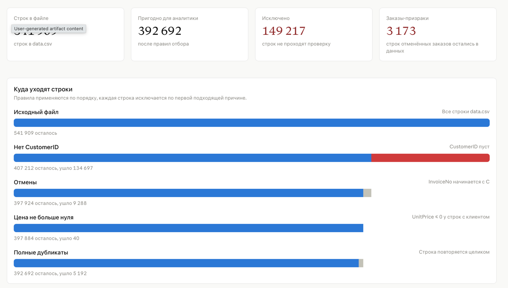

# Практическое занятие 2.

**Группа Р4150**

- Буров С.А.
- Бушмелёв К.А.
- Садовая А.Р.
- Халдин Д.А.

### 1. Интерфейсы


### 2. Загрузка и предварительная обработка данных



Приложение `org.itmo.Main` за один запуск читает CSV, выполняет предобработку (`DatasetPreparatorSpark`), а затем аналитику (`SparkAnalyticsData`) на очищенных данных.

## Запуск

Сначала собрать jar (из корня проекта):

```bash
./gradlew jar
```

После любого изменения кода jar нужно пересобрать.

### Через Docker Compose

Spark устанавливать не нужно:

```bash
docker compose up --exit-code-from spark-submit
```

Поднимаются Spark master и worker, затем на кластере выполняется задача. После её завершения всё останавливается. Результаты выводятся в строках `spark-submit-1` вместе с логами Spark и сохраняются на хосте в папку `output/`.

Чтобы видеть только результаты:

```bash
docker compose up --exit-code-from spark-submit 2>&1 | grep '^spark-submit' | grep -vE ' (INFO|WARN) '
```

### Через spark-submit

Нужен установленный Spark 4.x на Java 21:

```bash
spark-submit --class org.itmo.Main --master "local[*]" build/libs/practice-dataset-1.0-SNAPSHOT.jar data.csv output
```

Аргументы: путь к CSV-файлу с данными и папка для результатов.

Запуск `Main` напрямую из IDE не работает: Spark подключён как `compileOnly` и запускается через `spark-submit`.

## Результаты

Каждый результат аналитики сохраняется в CSV в отдельную подпапку `output/`:

| Папка | Результат |
|---|---|
| `output/top_five_products` | топ-5 самых популярных товаров по количеству проданных единиц |
| `output/client_order` | число заказов каждого клиента |
| `output/total_cost` | общая потраченная сумма каждого клиента |
| `output/mean_cost` | средний чек каждого клиента |

Spark записывает результат как папку: данные лежат в файле `part-00000-*.csv` внутри неё. При повторном запуске результаты перезаписываются.
